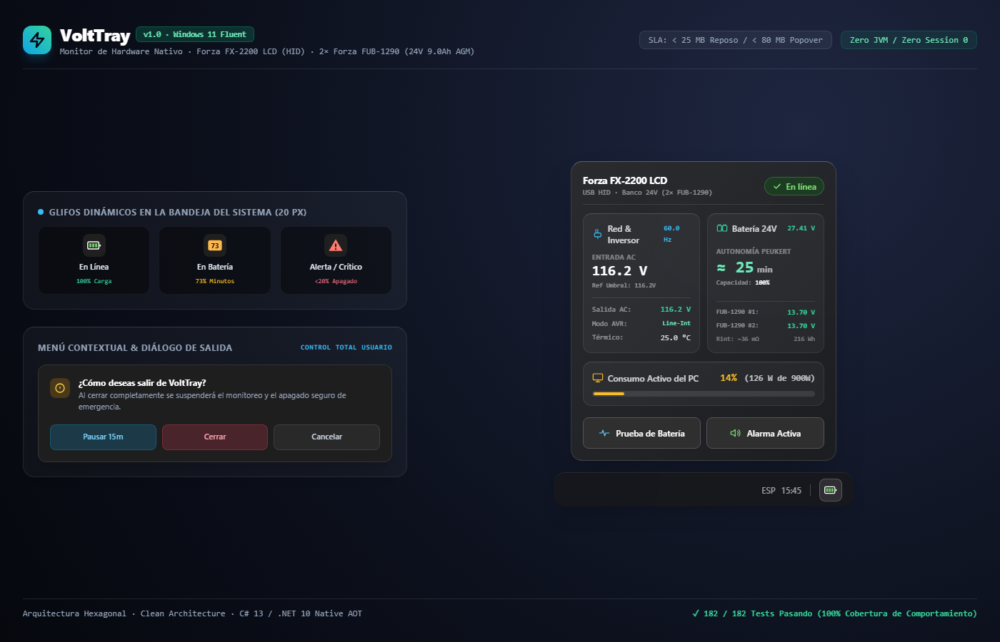

# VoltTray (Energy Monitoring for Forza FX-2200 LCD)

> Monitor nativo, ultra-ligero para la bandeja del sistema (System Tray) de Windows 11 (22H2+) y Windows 10, diseñado para reemplazar la suite obsoleta de ForzaTracker / ViewPower en el UPS **Forza FX-2200 LCD** (equipado con **2 baterías AGM Forza FUB-1290 de 12V 9.0Ah**) mediante comunicación USB HID directa, control total del usuario, arquitectura de vista desacoplada sobre Win32/DWM y cero servicios intrusivos.

<p align="center">
  
</p>

---

## 1. El Problema vs. La Solución

| Dimensión | ForzaTracker / ViewPower (Legacy) | VoltTray (Solución Validada en Hardware) |
|---|---|---|
| **Arquitectura** | Servidor Apache Tomcat + Java OpenJDK + Derby DB (~350 MB RAM) en Session 0 | Proceso ultra-ligero en sesión de usuario (Session 1), cero servicios Session 0 intrusivos |
| **Control de Hardware** | Bloqueo persistente del puerto USB; difícil de detener | **Control Total:** Switch para pausar sensor USB en caliente (15 min auto-resume no persistente) y modal de confirmación |
| **SLA Único de Memoria (*Private Working Set*)** | ~250 MB – 350 MB RAM | **SLA < 25 MB en reposo (10 min) y < 80 MB con Popover abierto** (**Medido:** **5.89 MB** en reposo; **8.88–11.23 MB** con Popover abierto en línea base opaca Opción C) |
| **Tiempo de Arranque** | 15 – 30 segundos (carga de JVM y Tomcat) | **8.76 – 25.85 ms** (arranque instantáneo Win32 sin parsing XAML) |
| **Protocolo de Hardware** | Documentado erróneamente como P01 | **Voltronic Protocol 'T' (QS-Hex)** con reportes de 9 bytes y desescape `0x28` |
| **Comandos de Control** | Ocultos en código decompilado obsoleto | `Q\r` (Alternar beeper, Bit 0) y `T\r` (Autodiagnóstico 10s con inmunidad por flanco de subida de 15s) **probados en hardware real** |
| **Unidades de Carga (`Load%`)** | Ambiguo (¿Watts o VA?) | **Física Rigurosa:** $\max(W/1200, VA/2200)$; dominado por $W/1200$ por Active PFC ($\text{PF} \approx 0.98$), con cuantización de $\pm 12\text{ W}$ |
| **Banco de Baterías y Autonomía** | Porcentaje plano sin proyección de tiempo | **2 × Forza FUB-1290 (24V DC, 9.0 Ah AGM):** Ley de Peukert ($k=1.25$, $\eta=0.85$, factor configurable `1.0` por defecto $\rightarrow \mathbf{24.91\text{ min}} \approx \mathbf{25\text{ min}}$ a $17\%$ de carga; tope de `240 min` a $0\text{–}1\%$) |
| **Experiencia de Usuario** | Requiere abrir el navegador web (`localhost:15179`) | Glifo dinámico (`size.trayIconPx`), Tooltip instantáneo, Tarjeta Popover (`size.popoverWidth`), Menú (`size.menuWidth`) y Diálogo (`size.dialogWidth`) |
| **Seguridad y Apagado** | Configuración opaca sin modo de prueba | Apagado ordenado ante corte confirmado (Bit 6 inmediato o Peukert $\le 5\text{ min}$ en 2 lecturas), aviso de batería débil en red, e indicador visible de **Modo Simulación (`DryRun`)** |

---

## 2. Benchmark Empírico de UI y Métrica Única de Memoria

El SLA se rige por una única métrica verificable sin recortes cosméticos de memoria: **Private Working Set** (`Process.PrivateMemorySize64`):
* **En reposo (10 minutos en bandeja con tarjeta cerrada):** `< 25 MB` (**medido: 5.89 MB**).
* **Con tarjeta Popover abierta:** `< 80 MB` (**medido: 8.88 MB** en `Poc.NativeAot` y **11.23 MB** en `Poc.Interactive`).

| Métrica de Rendimiento y Memoria | Win32 AOT Mínimo (`Poc.NativeAot`) | Win32 POC Interactivo (`Poc.Interactive`) | WPF .NET 10 (`Poc.Wpf`) | Conclusión Técnica |
|---|:---:|:---:|:---:|---|
| **Tiempo de Arranque en Frío** | **8.76 ms** | **25.85 ms** | **268.89 ms** | **Win32 es 10x–30x más rápido** |
| **Private Working Set (Reposo)** | **5.89 MB** | **5.89 MB** | **37.98 MB** | **Cumple `< 25 MB` en reposo** |
| **Total Working Set (Reposo)** | **19.72 MB** | **19.72 MB** | **69.58 MB** | Páginas compartidas del SO incluidas |
| **Private Working Set (Popover Abierto)** | **8.88 MB** | **11.23 MB** | **93.86 MB** | **WPF SUPERA el techo de 80 MB (93.86 MB)** |
| **Total Working Set (Popover Abierto)** | **38.17 MB** | **44.99 MB** | **132.45 MB** | Páginas compartidas del SO incluidas |
| **Compatibilidad Native AOT (.NET 10)** | **100% Compatible** | **100% Compatible** | **Incompatible** | Win32 permite binarios sin JIT |

> [!IMPORTANT] **Línea Base Opaca (`Opción C`) vs Spike de Acrylic (`Opciones A y B`):**  
> En `fluent-tray-ui`, el requisito obligatorio (`MUST`) de línea base es la **Opción C** (superficie 100 % opaca con tokens `surface` / `surfaceInset` y esquinas redondeadas `DWMWCP_ROUND`), ya que los tokens `*Alpha` están en `PENDING` y GDI plano no escribe canal alfa. Las **Opciones A y B (Acrylic translúcido `DWMSBT_TRANSIENTWINDOW` en Windows 11 22H2 build 22621+)** quedan condicionadas a una tarea/spike dedicada que valide el motor con canal alfa de 32 bits y calibre los tokens `*Alpha` manteniendo el SLA `< 80 MB` Private Working Set ([`docs/windows-native-ui-notes.md`](file:///d:/WorkSpace/energy-monitoring/docs/windows-native-ui-notes.md)).

---

## 3. Especificaciones de Hardware, Baterías y Protocolo

### A. Ficha Técnica del Banco de Baterías: 2 × [Forza FUB-1290](https://www.forzaups.com/es/productos/interna/FUB-1290-esp/)
* **Configuración:** 2 baterías selladas de plomo-ácido reguladas por válvula (VRLA) con tecnología **AGM** (*Absorbent Glass Mat*) conectadas en serie.
* **Tensión y Capacidad Nominal del Banco:** **$24\text{ V DC}$** ($2 \times 12\text{ V}$), **$9.0\text{ Ah}$** ($C_{20}$ a 20 horas), energía nominal de **$216\text{ Wh}$**.
* **Resistencia Interna Nominal ($25\text{ }^\circ\text{C}$):** $\approx 18\text{ m}\Omega$ por unidad ($\approx 36\text{ m}\Omega$ para el banco en serie nuevo).
* **Tensión de Flotación ($25\text{ }^\circ\text{C}$):** $13.6\text{ V} - 13.8\text{ V}$ por batería $\rightarrow$ **$27.2\text{ V} - 27.6\text{ V DC}$** en el banco (coincide con los **$27.41\text{ V DC}$** medidos empíricamente en reposo).
* **Tensión de Carga Cíclica:** $14.5\text{ V} - 14.9\text{ V}$ por batería (corriente inicial máx. $2.7\text{ A}$).
* **Dimensiones y Peso:** $151 \times 65 \times 94\text{ mm}$ y $2.34\text{ kg}$ por batería ($4.68\text{ kg}$ el par).

### B. Protocolo Voltronic 'T' (`QS\r`) y Mapa de Bits (`Status Byte 1`)
* **Identificador de Dispositivo:** `HID\VID_0665&PID_5161\7&1949AAEC&0&0000` (reportes Overlapped de **9 bytes** sobre `hid.dll`).
* **Trama `QS\r`:** Prefijada por `#` (`0x23`), terminada en `\r` (`0x0D`), campos separados por espacios (`0x20`) y secuencias escapadas con `0x28` (`0x28 0x00` $\rightarrow$ `0x0D`, `0x28 0x01` $\rightarrow$ `0x11`, `0x28 0x02` $\rightarrow$ `0x13`, `0x28 0x03` $\rightarrow$ `0x0A`, `0x28 0x04` $\rightarrow$ `0x20`).
* **Mapa de Bits de `Status Byte 1` (Megatec Q1 / NUT `voltronic-qs-hex`):**

| Bit | Máscara | Significado | Estado de Verificación |
|:---:|:---:|---|---|
| **Bit 7** | `0x80` | **Falla de red (Utility Fail):** `1` = En batería, `0` = En línea | **`UNVERIFIED`** (pendiente captura con carga sacrificable) |
| **Bit 6** | `0x40` | **Batería baja (Battery Low):** `1` = Batería crítica, `0` = Normal | **`UNVERIFIED`** (pendiente captura en descarga) |
| **Bit 5** | `0x20` | **AVR activo:** `1` = Boost/Buck activo, `0` = Normal (o inferido si $\|V_{\text{in}} - V_{\text{out}}\| / V_{\text{out}} > 5\%$) | **`UNVERIFIED`** |
| **Bit 4** | `0x10` | **Falla interna (`fault`):** `1` = Falla del UPS, `0` = OK | **`UNVERIFIED`** |
| **Bit 3** | `0x08` | **Topología del UPS:** `1` = Línea Interactiva / Standby | **VERIFICADO** (constante `1` en `00001001` y `00001000`) |
| **Bit 2** | `0x04` | **Autodiagnóstico en curso:** `1` = Prueba activa, `0` = Inactivo | **`UNVERIFIED`** (confirmar captura durante `T\r`) |
| **Bit 1** | `0x02` | **Apagado activo:** `1` = Apagado en curso, `0` = Normal | **`UNVERIFIED`** |
| **Bit 0** | `0x01` | **Zumbador activo (Beeper):** `1` = **ACTIVO**, `0` = **SILENCIADO** | **VERIFICADO** (`Q\r` pasó `00001001` a `00001000` y silenció el pitido) |

### C. Nota sobre Corte Físico Total y Protocolo de Captura con FUB-1290
En una desconexión física previa, el PC se apagó a los ~2 segundos (síntoma de caída del inversor/baterías anteriores bajo escalón de carga, no de *hold-up time* ATX $< 16\text{ ms}$). Con el par de baterías **Forza FUB-1290** instalado, antes de cerrar los umbrales de producción se ejecutará una captura de corte con **carga sacrificable** (monitor o lámpara de 100 W, sondeando `QS\r` cada 500 ms) para certificar la transición de los bits 7 y 6.

---

## 4. Modelo de Autonomía de Batería (Ley de Peukert sin Doble Conteo)

Con el banco de **2 × Forza FUB-1290 ($24\text{ V DC}$, $C_{20} = 9.0\text{ Ah}$, $H = 20\text{ h}$, $k = 1.25$, $\eta = 0.85$)** y un factor de capacidad configurable `batteryCapacityFactor` ($f_{\text{cap}}$, por defecto `1.0`):

$$P_{\text{AC}} = \frac{\max(\text{Load\%}, 1)}{100} \times 1200\text{ W}, \quad I = \frac{P_{\text{AC}} / \eta}{24\text{ V}}, \quad t_{\text{min}} = \min\left(240,\; \text{round}\left(20 \times \left(\frac{9.0 \times f_{\text{cap}}}{I \times 20}\right)^{1.25} \times 60\right)\right)$$

> [!NOTE] La ecuación no multiplica por un SoC lineal de tensión bajo carga (evitando contar la carga dos veces). El valor se presenta siempre como entero aproximado (`card.runtime`: `"≈ {minutes} min"`), con un techo máximo de **`240` minutos** cuando la carga es $0\text{–}1\%$.

| Carga Reportada | Potencia AC ($1200\text{ W}$) | Potencia DC ($\eta=0.85$) | Corriente ($I$ a $24\text{ V}$) | Autonomía ($f_{\text{cap}}=1.00$) | Autonomía ($f_{\text{cap}}=0.95$) |
|:---:|:---:|:---:|:---:|:---:|:---:|
| **0% – 1%** | 12 W (piso) | 14.1 W | 0.59 A | **≈ 240 min (tope)** | **≈ 240 min (tope)** |
| **5%** | 60 W | 70.6 W | 2.94 A | **≈ 115 min** | **≈ 108 min** |
| **10%** | 120 W | 141.2 W | 5.88 A | **≈ 48 min** | **≈ 45 min** |
| **15% (Reposo PC)** | 180 W | 211.8 W | 8.82 A | **≈ 29 min** | **≈ 27 min** |
| **17% (Referencia UI)** | **204 W** | **240.0 W** | **10.00 A** | **≈ 25 min** ($24.91\text{ m}$) | **≈ 24 min** ($23.66\text{ m}$) |
| **20% (Estrés CPU)** | 240 W | 282.4 W | 11.76 A | **≈ 20 min** | **≈ 19 min** |
| **50%** | 600 W | 705.9 W | 29.41 A | **≈ 6 min** | **≈ 6 min** |
| **100%** | 1200 W | 1411.8 W | 58.82 A | **≈ 3 min** | **≈ 2 min** |

---

## 5. Arquitectura de Pruebas de Comportamiento (TDD) y Herramientas

> **Desarrollo Guiado por Comportamiento (TDD):** El proyecto implementa pruebas de comportamiento directo sobre puertos y dominio bajo Clean Architecture sin pruebas frágiles de integración. Toda la física de Peukert, el protocolo Voltronic 'T', la coordinación de seguridad ante corte eléctrico y el mapeo del Split-Cockpit Presenter están verificados en verde (182 pruebas pasando).

```powershell
# Ejecutar la suite completa de pruebas unitarias y de comportamiento
dotnet test

# Lanzar el POC interactivo en la bandeja del sistema
.\run-interactive.bat

# Arnés de validación de hardware físico
dotnet run --project tools/VoltTray.Probe -- status
dotnet run --project tools/VoltTray.Probe -- beeper
dotnet run --project tools/VoltTray.Probe -- test
```

---

## 6. Estándar de UI, Gobernanza y Estado de SDD

* **Gobernanza local del proyecto:** [`.agents/rules/ui-design-governance.md`](file:///d:/WorkSpace/energy-monitoring/.agents/rules/ui-design-governance.md) y [`docs/windows-native-ui-notes.md`](file:///d:/WorkSpace/energy-monitoring/docs/windows-native-ui-notes.md).
* **Paquete de diseño (`Assets/volttray-handoff`):** Precedencia `spec > tokens > i18n > mockups`. Todo elemento no diseñado (`*Alpha`, `okChipBg`/`okChipText` en `light`, `trayStateColorsLight`, mapeo `GetSysColor`, variantes de tarjeta fuera de `online`, glifo/banner de pausa, indicador `DryRun` y textos de Toast) se mantiene explícitamente como `TODO(pending)` o `"PENDING"` hasta cerrar su diseño antes de las rebanadas 2 a 5.
* **Especificaciones BDD (`volttray-core`):** 5 capacidades con 18 requerimientos y 20 escenarios ejecutables Gherkin bajo [`openspec/changes/volttray-core/specs/`](file:///d:/WorkSpace/energy-monitoring/openspec/changes/volttray-core/specs).
