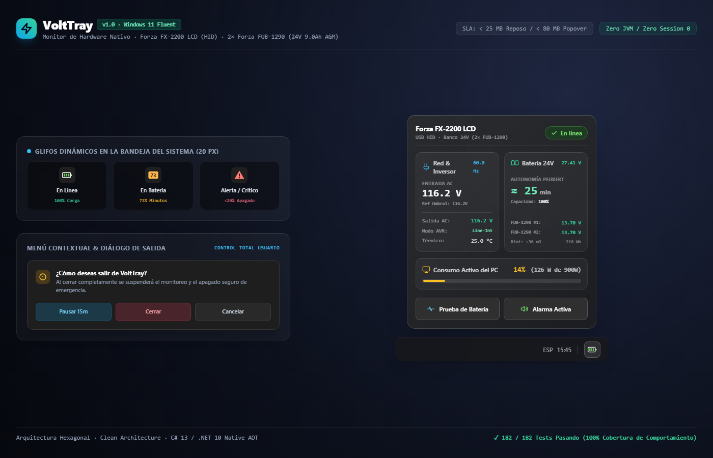

# VoltTray — Multi-UPS Energy Monitoring for Windows

Monitor nativo y ultra-ligero para la bandeja del sistema de **Windows 11 (22H2+)** y **Windows 10** en **.NET 10 (`net10.0-windows`)**, diseñado para reemplazar suites heredadas basadas en Tomcat/Java mediante comunicación USB HID directa (**Voltronic Protocol 'T' QS-Hex** y **Megatec ASCII** con `ProtocolNegotiator`). Construido bajo **Arquitectura Hexagonal + Vertical Slices**, renderizado vectorial nativo con **SkiaSharp + Svg.Skia** e interoperabilidad Win32 100 % `[LibraryImport]` lista para Native AOT, manteniendo un consumo real de **~6.7 MB** de memoria privada en ejecución (SLA `< 25 MB` en reposo).

<p align="center">
  
</p>

---

## Inicio Rápido

### Requisitos
- **Sistema operativo:** Windows 10 o Windows 11 (`win-x64`).
- **SDK:** [.NET 10 SDK](https://dotnet.microsoft.com/download).

### Comandos principales

```powershell
# Compilar toda la solución (0 warnings)
dotnet build VoltTray.sln --no-incremental

# Ejecutar pruebas unitarias y de arquitectura
dotnet test VoltTray.sln --no-build --filter "FullyQualifiedName!~MemorySLA&FullyQualifiedName!~Win32Integration"

# Ejecutar integración Win32 y verificación de SLA de memoria (aislados)
dotnet test tests\VoltTray.Tests\VoltTray.Tests.csproj --no-build --filter "FullyQualifiedName~Win32UiIntegrationTests"
dotnet test tests\VoltTray.Tests\VoltTray.Tests.csproj --no-build --filter "FullyQualifiedName~MemorySLA"

# Ejecutar en modo simulado (sin UPS físico)
dotnet run --project src/VoltTray -- --simulate

# Ejecutar en modo simulado con píldora en la barra de tareas
dotnet run --project src/VoltTray -- --simulate --taskbar-pill

# Ejecutar contra UPS real simulando únicamente el apagado del SO
dotnet run --project src/VoltTray -- --dry-run

# Diagnóstico de solo lectura sobre HID y protocolo
dotnet run --project src/VoltTray -- --inspect
```

---

## Arquitectura (Hexagonal + Vertical Slices)

Las dependencias apuntan siempre hacia el núcleo (`Shared <- Core <- Infrastructure / UI <- VoltTray`) y están validadas automáticamente por `ArchitectureBoundaryTests`:

| Proyecto | Rol | Contenido Principal |
|---|---|---|
| `VoltTray.Shared` | Shared Kernel (0 dependencias internas) | `Result<T>`, `DomainError`, `ElectricalConstants`, `ApplicationDefaults`, `ApplicationExitCodes` |
| `VoltTray.Core` | Dominio (Vertical Slices) | `Battery/` (bancos 12V–48V, `PeukertEstimator`), `Telemetry/` (`UpsTelemetry`, `IUpsDevicePort`), `Safety/` (`ShutdownCoordinator`, `SelfTestImmunityTracker`), `Diagnostics/`, `Events/` (`InProcessEventBus`) |
| `VoltTray.Infrastructure` | Adaptadores de Hardware y SO | `Hid/` (`Win32HidUpsPort`, `AsyncRetryPolicy`, `SimulatedUpsDevicePort`), `Protocol/` (`ProtocolNegotiator`, `VoltronicParser`, `MegatecAsciiProtocol`), `Diagnostics/` (`InProcessTelemetryProbe`, `SafeExecutionMiddleware`), `OS/` (`WindowsShutdownPort`, `WindowsNotificationPort`) |
| `VoltTray.UI` | Interfaz Win32 + SkiaSharp (Atomic Design) | `Tokens/` (Light/Dark + WCAG), `Interop/` (`GdiNative` `[LibraryImport]`), `Atoms/` (`SkiaSvgIconLibrary`, `TrayGlyphs/`), `Tray/`, `Popover/` (`SkiaPopoverSurfaceRenderer`, `PopoverPainter`), `TaskbarPill/`, `Dialogs/` |
| `VoltTray` | Composition Root y CLI | `Program`, `Hosting/` (`TrayMonitorBootstrapper`, `ApplicationOptionsParser`), `HostLifecycle`, `Subscribers/`, `Cli/` (`InspectModeStrategy`) |

---

## Capacidades y Contrato Técnico

### Protocolo Multi-UPS y Física de Batería
| Capacidad | Implementación |
|---|---|
| **Negociación de protocolo** | `ProtocolNegotiator` detecta y adapta **Voltronic Protocol 'T' (QS-Hex)** (reportes Overlapped de 9 bytes con desescape `0x28`) y **Megatec ASCII** (`Q1\r`). |
| **Control de hardware** | Comandos `Q\r` (alternar alarma sonora, Bit 0) y `T\r` (autodiagnóstico de 10 s con inmunidad por flanco de subida de 15 s). |
| **Modelo de autonomía (Peukert)** | Inferencia de bancos de 12V–48V (`BatteryBankInference`) y estimación de autonomía mediante ley de Peukert ($k = 1.25$, $\eta = 0.85$, tope de `240 min` en reposo). |
| **Resiliencia y seguridad** | `ConnectAsync` con reintentos acotados cancelables en `< 100 ms`, manejo explícito con `Result<T>`, `SafeExecutionMiddleware` hacia log `.jsonl`, protección contra lecturas anómalas (`TelemetryPlausibilityGuard`) y modo `--dry-run`. |
| **Inspección segura (`--inspect`)** | Emite únicamente consultas de lectura modeladas en `UpsDiagnosticInquiry`, sin comandos mutadores por defecto. |

### Interfaz Nativa Windows 11 y Rendimiento
| Dimensión | Especificación |
|---|---|
| **Motor gráfico** | `SkiaSharp` + `Svg.Skia` con 25 íconos `.svg` embebidos (`ISvgIconLibrary`), renderizado a 32-bpp BGRA premultiplicado. |
| **Popover Split-Cockpit** | Tarjeta de `372×356 px` con esquinas redondeadas `DWMWCP_ROUND`, detección automática de tema (`AppsUseLightTheme`), omisión limpia de métricas `Unavailable` y botones reales de `44 px` con hover y navegación por teclado. |
| **Ícono de bandeja y Taskbar Pill** | Glifo dinámico de 32-bpp ARGB adaptado a `SystemUsesLightTheme` y DPI (`16/20/24/32 px`), más píldora opcional `--taskbar-pill` anclada en `Shell_TrayWnd` con ocultamiento automático en pantalla completa. |
| **Interop y memoria** | Cero `[DllImport]` en `src/` (`[LibraryImport]` únicamente), serialización invariante lista para Native AOT y **~6.7 MB** de memoria privada medida en ejecución simulada. |

---

## Próximas Iteraciones (Roadmap)

| Área | Alcance planificado |
|---|---|
| **Apagado por umbral crítico de batería (%)** | Notificación previa visible al usuario antes de ejecutar el apagado ordenado del sistema, disparado al alcanzar un porcentaje crítico de batería (valor fijo seguro por defecto inicialmente, ajustable luego por el usuario). |
| **Opciones y personalización de temas** | Ventana/apartado de configuración persistente para ajustar umbrales de seguridad, elegir y personalizar temas visuales (Claro, Oscuro, Automático) y gestionar preferencias de píldora y notificaciones. |
| **Instalador y selector de modelo / modo de ícono** | Selección durante la instalación del modelo de UPS (`Forza NT-2401PRO` vs `Forza FX-2200 LCD` legacy) y del modo de ícono en barra — **versión larga (Estilo A, batería horizontal + `%`)** o **versión reducida/compacta (Estilo D, anillo de estado circular `24×24`)** — persistidos en `%LOCALAPPDATA%\VoltTray\settings.json` y conmutables desde el menú contextual (con vista previa en el panel de opciones). |
| **Telemetría persistida e historial** | Registro local de consumo diario (`kWh`), picos de carga, eventos AVR y calendario mensual con días de corte (`5 días`, `Mes` y `Días con cortes`), respetando días sin uso de la PC. |
